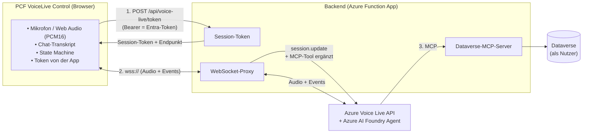
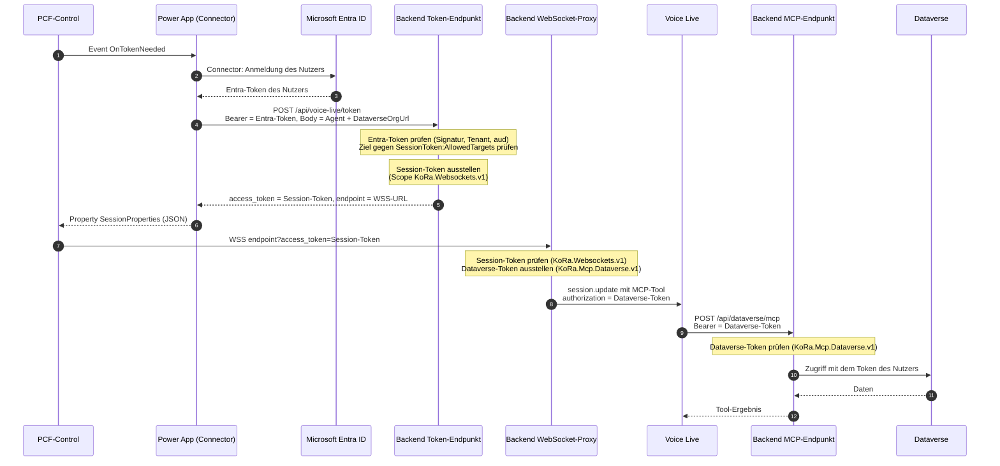

# VoiceLive PCF Control

Echtzeit-Sprachdialog mit einem KI-Assistenten für **Power Apps** und **Dynamics 365** – realisiert als PowerApps Component Framework (PCF) Control.

Das Control nimmt Sprache über das Mikrofon auf, streamt sie in Echtzeit an einen **Azure AI Foundry Agent** (über die **Azure Voice Live API**) und gibt die Antwort des Agenten als synthetische Sprache wieder. Eine integrierte Chat-Ansicht zeigt das Transkript live im Messenger-Stil an. Eine animierte Orb-Visualisierung signalisiert jederzeit den aktuellen Zustand (Zuhören, Nutzer spricht, KI spricht, Fehler).

> **Hinweis:** Dieses Repository enthält das **Frontend** (das PCF-Control und das Solution-Packaging) und im Ordner `backend/` das zugehörige **Backend** (Azure Function App). Zugangsdaten für Azure und Dataverse werden bewusst **nicht** im Client gehalten, sondern über das Backend vermittelt: einen **WebSocket-Proxy** zu Voice Live und einen **MCP-Server** für den Dataverse-Zugriff. Das Backend ist eine Betriebsvoraussetzung (siehe [Architektur](#architektur) und [Backend](#backend)).

---

## Inhaltsverzeichnis

- [Architektur](#architektur)
- [Voraussetzungen](#voraussetzungen)
- [Projekt einrichten](#projekt-einrichten)
- [Solution bauen & importieren](#solution-bauen--importieren)
- [Backend](#backend)
- [Konfiguration in Power Apps](#konfiguration-in-power-apps)
- [Control-Properties](#control-properties)
- [Verfügbare npm-Scripts](#verfügbare-npm-scripts)
- [Projektstruktur](#projektstruktur)
- [Versionierung](#versionierung)
- [Sicherheitshinweise](#sicherheitshinweise)
- [Technologie-Stack](#technologie-stack)

---

## Architektur

Das Control kommuniziert nicht direkt mit Azure, sondern über ein serverseitiges Backend. Dadurch bleiben Agent-Zugangsdaten und der Dataverse-Zugriff auf dem Server. Die Benutzeridentität stammt aus dem Entra-Token des Nutzers, das der Server prüft – nicht aus Werten, die der Client frei setzt.



**Ablauf einer Session:**

1. Der Maker bindet das Control ein und setzt die Bound-Property `Connected = true` (z. B. per Button).
2. Das Control löst das Event `OnTokenNeeded` aus. Die App ruft den Custom Connector „KoRa VoiceLive“ (`GetSessionToken`) und setzt die Property `SessionProperties` (die Antwort des Connectors als JSON). Der Connector meldet den Nutzer per Entra an und ruft das Backend auf:
   `POST /api/voice-live/token` mit `Authorization: Bearer <Entra-Token>` und dem Body `AgentEndpoint`, `AgentProjectName`, `AgentId`, `DataverseOrgUrl`. Das Backend prüft Token und Ziel und antwortet mit einem kurzlebigen **Session-Token** (gültig bis zum Ablauf des Entra-Tokens) und dem WebSocket-`endpoint` des Backends. Schlägt der Aufruf fehl, setzt die App `SessionProperties` auf `error:<eindeutiger Zusatz>:<Meldung>`, und das Control zeigt die Meldung sofort an.
3. Das Control öffnet eine WebSocket-Verbindung zum Backend:
   `<endpoint>?access_token=<Session-Token>` (also `wss://<Backend>/api/voice-live/ws?access_token=…`)
4. Nach dem Öffnen sendet das Control eine `session.update`-Nachricht mit Voice-, VAD-, Rauschunterdrückungs- und Transkriptions-Einstellungen. Das Backend ergänzt darin das MCP-Tool für Dataverse.
5. Mikrofon-Audio (24 kHz PCM16) wird gestreamt; die Antwort des Agenten kommt als Audio-Deltas zurück und wird abgespielt. Braucht der Agent Daten aus Dataverse, ruft Voice Live den MCP-Server des Backends auf (3). Das Backend greift dann mit dem Token des Nutzers auf Dataverse zu, sodass dessen Berechtigungen gelten.
6. Live-Transkripte (Nutzer & KI) werden im Chat-Panel angezeigt und über die Output-Property `Transcript` bereitgestellt.
7. Bei unerwartetem Verbindungsabbruch versucht das Control automatisch einen Reconnect (exponentielles Backoff, inkl. Wiedereinspielen des bisherigen Gesprächsverlaufs). Dabei wird ein neues Session-Token geholt.

Das Backend stellt folgende Endpunkte bereit (Details im Abschnitt [Backend](#backend)):

| Endpunkt | Zweck | Aufgerufen von |
|----------|-------|----------------|
| `POST /api/voice-live/token` | Entra-Token gegen ein Session-Token tauschen | Control |
| `WSS /api/voice-live/ws` | WebSocket-Proxy zur Azure Voice Live API | Control |
| `POST /api/dataverse/mcp` | MCP-Server mit den Dataverse-Werkzeugen | Voice Live |

---

## Voraussetzungen

| Tool | Version | Installation |
|------|---------|--------------|
| **Node.js** | 18+ | [nodejs.org](https://nodejs.org/) |
| **npm** | (kommt mit Node.js) | — |
| **.NET SDK** | 6.0+ (Backend: 10) | [dotnet.microsoft.com](https://dotnet.microsoft.com/download) |
| **.NET Framework 4.6.2 Targeting Pack** | — | [Download](https://dotnet.microsoft.com/download/dotnet-framework/net462) |
| **Power Platform CLI** (`pac`) | aktuell | siehe unten |
| **Azure Functions Core Tools** | v4 | nur für das Backend lokal, [Download](https://learn.microsoft.com/azure/azure-functions/functions-run-local) |

> Das .NET SDK und das Targeting Pack werden **nur für das Bauen der Solution** (`.cdsproj`) und des Backends benötigt, nicht für die reine Control-Entwicklung.

### Power Platform CLI installieren

**Option A — als .NET Global Tool (empfohlen):**

```bash
dotnet tool install --global Microsoft.PowerApps.CLI.Tool
```

**Option B — als VS Code Extension:**

In VS Code die Extension **„Power Platform Tools"** installieren (Publisher: Microsoft). Diese bringt die `pac` CLI automatisch mit.

Nach der Installation prüfen:

```bash
pac --version
```

---

## Projekt einrichten

```bash
# 1. Repository klonen
git clone <REPO-URL>
cd VoiceLive-PCF-Control

# 2. Dependencies installieren
npm install

# 3. Control bauen
npm run build

# 4. Lokalen Test-Harness starten
npm start
# oder mit Auto-Reload:
npm run start:watch
```

> **Mikrofon-Hinweis:** Das Control benötigt `getUserMedia`, das nur über **HTTPS** bzw. `localhost` verfügbar ist. Der lokale Test-Harness und Power Apps erfüllen diese Bedingung. Zusätzlich muss ein erreichbares Backend konfiguriert sein, damit eine Session zustande kommt.

---

## Solution bauen & importieren

```bash
# 1. Control bauen (falls noch nicht geschehen)
npm run build

# 2. Solution bauen
cd Solution
dotnet build /p:configuration=Release

# → ZIP-Datei liegt unter: Solution/bin/Release/Solution.zip
```

## Versionierung

Vor jedem PowerApps-Import müssen **beide** Versionen synchron hochgezählt werden:

1. **Control-Version** in `VoiceLiveControl/ControlManifest.Input.xml`:
   ```xml
   <control ... version="1.38.0" ...>
   ```

2. **Solution-Version** in `Solution/src/Other/Solution.xml`:
   ```xml
   <Version>1.38.0.0</Version>
   ```

> Power Apps aktualisiert ein bereits importiertes Control nur bei **höherer** Versionsnummer. Wird die Version nicht erhöht, greift der neue Code im Zielsystem nicht.

---

**Import in Power Apps:**

1. [make.powerapps.com](https://make.powerapps.com) öffnen
2. **Lösungen → Importieren →** ZIP-Datei hochladen
3. Die Solution wird als **managed + unmanaged** paketiert (Publisher: `AdessoSE`, Prefix: `adesso`)

### Custom Connector „KoRa VoiceLive“

Die Solution enthält den Connector `adesso_KoRaVoiceLive` (Ordner `Solution/src/Connectors/`) mit einer einzigen Operation, `GetSessionToken` (`POST /api/voice-live/token`). Der Connector meldet den Nutzer per OAuth (Microsoft Entra) an und schickt dessen Token als Bearer-Token mit; die Antwort enthält das Session-Token (`access_token`) und den WebSocket-Endpunkt des Backends (`endpoint`) für das Control. Das Control ruft den Connector nicht selbst auf (das kann nur die App), sondern fordert beides über das Event `OnTokenNeeded` an und bekommt die Antwort als JSON in der Property `SessionProperties`. Das Control braucht deshalb weder die Adresse des Backends (sie steht nur im Connector, Umgebungsvariable `adesso_KoRaVoiceLiveHost`) noch Angaben zum Agenten: Agent, Projekt, Endpoint und Dataverse-Org gibt die App dem Connector mit. Ein vollständiges Beispiel steht unter [Beispiel: Canvas-App](#beispiel-canvas-app).

Der Zusatz mit der Uhrzeit sorgt dafür, dass sich der Wert bei jedem Fehler ändert, denn Power Apps meldet dem Control nur Änderungen. Das Event gibt es nur in Canvas-Apps und Custom Pages, nicht in klassischen Formularen modellgesteuerter Apps.

Umgebungsabhängige Werte stehen in Umgebungsvariablen (`Solution/src/environmentvariabledefinitions/`), die beim Import abgefragt werden:

| Umgebungsvariable | Inhalt |
|-------------------|--------|
| `adesso_KoRaVoiceLiveHost` | Host der Function App, ohne `https://` |
| `adesso_KoRaVoiceLiveClientId` | Client-ID der App-Registrierung, über die sich der Connector anmeldet (OAuth-Client) |
| `adesso_KoRaVoiceLiveTenantId` | Entra-Mandant der Nutzer |
| `adesso_KoRaVoiceLiveResourceUrl` | Anwendungs-ID-URI der Backend-API, z. B. `api://<Client-ID der Backend-App>` |
| `adesso_KoRaVoiceLiveScope` | Scope der Backend-API, z. B. `api://<Client-ID der Backend-App>/access_as_user` |
| `adesso_KoRaVoiceLiveClientSecret` | Client Secret der Client-Registrierung |

> **Sicherheit des Secrets:** Die Variable ist vom Typ *Text*, ihr Wert liegt unverschlüsselt in Dataverse und ist für jeden lesbar, der die Variablenwerte sehen darf. Das ist nur für Tests gedacht. Für Produktion legst du die Variable als Typ *Secret* an (Azure Key Vault): Ressourcenanbieter `Microsoft.PowerPlatform` in der Subscription registrieren, die Rolle *Key Vault Secrets User* am Vault für den Dataverse-Dienstprinzipal (`00000007-0000-0000-c000-000000000000`) und für die Nutzer vergeben, die den Connector speichern, und als Wert den Pfad `/subscriptions/<id>/resourceGroups/<rg>/providers/Microsoft.KeyVault/vaults/<vault>/secrets/<name>` setzen.

Der Connector nutzt OAuth 2.0 mit Microsoft Entra ID und **On-behalf-of-Login** (`enableOnbehalfOfLogin`). Dadurch entsteht die Verbindung per Single Sign-On ohne eigenes Anmeldefenster, sobald diese Voraussetzungen erfüllt sind:

- Der Dienstprinzipal **Azure API Connections** (`fe053c5f-3692-4f14-aef2-ee34fc081cae`) existiert im Tenant.
- Die Client-Registrierung gibt eine API frei: Anwendungs-ID-URI `api://<Client-ID>`, ein Scope (z. B. `access_as_user`), und der Dienstprinzipal Azure API Connections ist dafür unter *API verfügbar machen → Autorisierte Clientanwendungen* eingetragen.
- Die Client-Registrierung hat die delegierte Berechtigung auf die Backend-API (Scope `access_as_user`) mit Administratorzustimmung.
- Die Backend-Registrierung hat die Client-Registrierung als autorisierte Clientanwendung für ihren Scope.

Nach dem Import fehlt eine Sache, die nicht in die Solution gehört:

1. **Umleitungs-URL:** im Connector unter *Sicherheit* „Update to unique redirect URL“ aktivieren, die angezeigte URL kopieren und in der Client-Registrierung unter *Authentifizierung* als Web-Umleitungs-URI eintragen.

Danach legt jeder Nutzer einmal eine Verbindung an. Ändert sich eine Umgebungsvariable, muss der Connector neu gespeichert werden, weil er die Werte beim Speichern übernimmt.

> **Update einer bestehenden Installation:** Ein Solution-Import ersetzt den Connector nur in Dataverse. Das Objekt, das Power Apps zur Laufzeit benutzt (Sicherheitseinstellungen, Antwortschema), wird dabei nicht aktualisiert, sondern nur bei der ersten Installation angelegt. Änderungen am Connector (z. B. neue Felder in der Antwort oder OBO) müssen im Connector-UI nachgezogen und mit *Connector aktualisieren* gespeichert werden. Alternativ das Objekt über die Power-Apps-Plattform-API löschen (`DELETE https://api.powerapps.com/providers/Microsoft.PowerApps/apis/<Name>?api-version=2016-11-01&$filter=environment eq '<Umgebungs-ID>'`), die Solution deinstallieren und neu importieren; dann übernimmt die Plattform alle Einstellungen aus der Solution.

---

## Backend

Das Backend liegt unter `backend/` (Azure Function App, .NET 10) und übernimmt Anmeldung, WebSocket-Proxy und Dataverse-Zugriff.

| Endpunkt | Zweck |
|----------|-------|
| `POST /api/voice-live/token` | Prüft das Entra-Token des Nutzers und das Ziel (Agent + Dataverse-Org) und stellt ein Session-Token aus |
| `WSS /api/voice-live/ws` | Relay zwischen Control und Voice Live; setzt im `session.update` das MCP-Tool ein |
| `POST /api/dataverse/mcp` | MCP-Server (stateless) mit den Werkzeugen `whoami`, `search`, `describe`, `read_query`, `create_record`, `update_record`, `delete_record` |
| `POST /api/deploy-agent` | Legt den Foundry Voice Agent mit der Audio-Konfiguration des Controls an bzw. aktualisiert ihn (Function Key) |

### Ausstellung der Tokens

Das Backend arbeitet mit drei Tokens. Das Entra-Token kommt vom Nutzer, die beiden anderen stellt das Backend selbst aus. Jedes ist verschlüsselt (ASP.NET Core Data Protection), wird nicht gespeichert und gilt höchstens bis zum Ablauf des Entra-Tokens.



| Token | Ausgestellt von | Scope (Purpose) | Verwendet für |
|-------|-----------------|-----------------|---------------|
| Entra-Token | Entra ID | – | Aufruf von `/api/voice-live/token`, wird vom Backend geprüft |
| Session-Token | `WebSocketTokenService` | `KoRa.Websockets.v1` | Anmeldung des Controls am WebSocket-Proxy |
| Dataverse-Token | `DataverseTokenService` | `KoRa.Mcp.Dataverse.v1` | Aufruf des MCP-Endpunkts durch Voice Live |

Die Scopes sind kryptografisch getrennt: Das Session-Token öffnet keinen Dataverse-Aufruf, das Dataverse-Token keinen WebSocket. Das Session-Token geht nur an das Control, das Dataverse-Token nur an Voice Live; es entsteht erst im Proxy.

**Lokal starten:**

```bash
cd backend/VoiceLiveSessionApi
func start
```

### Konfiguration

`backend/VoiceLiveSessionApi/appsettings.json`; App-Settings bzw. Umgebungsvariablen überschreiben die Werte, Abschnitte werden dabei mit `__` getrennt (z. B. `Dataverse__ClientId`). Geheimnisse (Client Secret, Schlüssel für den Schlüsselring) gehören nur als App-Setting bzw. Key-Vault-Referenz dorthin, nie in die JSON.

| Abschnitt | Einstellung | Zweck |
|-----------|-------------|-------|
| (oberste Ebene) | `TenantId` | Tenant, in dem sich die Nutzer anmelden |
| `DataProtection` | `KeyRingBlobUri` | Blob mit dem Schlüsselring für die Tokens |
| `SessionToken` | `UserTokenAudiences` | Erlaubte `aud`-Werte des Entra-Tokens |
| `SessionToken` | `AllowedTargets` | Zugelassene Kombinationen aus Agent und Dataverse-Org, je Ziel mit dem eigenen MCP-Server (`Mcp:Url`, `Mcp:Label`, `Mcp:AllowedTools`) |
| `Foundry` | `McpCallbackBaseUrl` | Öffentliche Adresse dieser App, unter der Foundry den MCP-Server aufruft. Gegen sie wird `Mcp:Url` (relativ, z. B. `./api/dataverse/mcp`) aufgelöst. Leer → `https://<WEBSITE_HOSTNAME>` (setzt App Service automatisch). Nötig nur bei Dev-Tunnel, Gateway oder Custom Domain |
| `Dataverse` | `ClientId`, `CertificateKeyVaultUrl`, `CertificateKeyVaultName` | Zugangsdaten der App für den On-Behalf-Of-Tausch |
| `Dataverse` | `WarmupTables` | Tabellen, deren Schema beim Ausstellen des Session-Tokens vorgeladen wird |
| `DeployAgent` | `ProjectEndpoint`, `AgentName`, `ModelDeploymentName`, `VoiceName`, `Language`, `Instructions` | Foundry-Projekt und Definition des Voice Agents. `Instructions` fehlt in der Datei, dann gilt der Standardtext in `DeployAgentOptions` |

### Caches und Aufwärmen

Die Dataverse-Zugriffe laufen mit dem Token des jeweiligen Nutzers. Alle Caches liegen nur im Arbeitsspeicher der Function-App-Instanz und sind nach Tenant, Nutzer und Org getrennt, damit kein Nutzer Metadaten eines anderen sieht. Ein Neustart oder Deploy leert sie.

| Cache | Inhalt | Lebensdauer |
|-------|--------|-------------|
| Dataverse-Verbindung (`ServiceClient`) | Eine Verbindung je Nutzer | 20 Minuten, höchstens 50 |
| Tabellenliste | Name und Anzeigename aller Tabellen, die der Nutzer sieht (für `search` und `describe tables/`) | 30 Minuten (Sliding) |
| Tabellen-Schema | Metadaten einer Tabelle (für `describe tables/<Tabelle>` und das Schreiben) | 30 Minuten (Sliding) |

Beim Ausstellen des Session-Tokens (`POST /api/voice-live/token`) startet im Hintergrund ein Aufwärmen: Es baut die Verbindung des Nutzers auf und lädt die Tabellenliste sowie die Schemas aus `Dataverse:WarmupTables`. Die Antwort an das Control wartet nicht darauf, ein Fehler wird nur geloggt, und der erste Aufruf lädt dann selbst. Ohne Dataverse-Konfiguration entfällt das Aufwärmen.

---

## Konfiguration in Power Apps

Nach dem Import kann das Control auf ein Canvas- oder Custom-Page-Formular gezogen werden. Die folgenden Pflicht-Properties müssen gesetzt werden (siehe [Control-Properties](#control-properties)):

- `SessionProperties` und das Event `OnTokenNeeded` – Session-Token und Backend-Endpunkt aus dem Connector (siehe [Custom Connector](#custom-connector-koravoicelive))
- `Connected` – an eine Variable/Toggle binden, um Sessions zu starten/beenden

Ziel-Agent (`AgentEndpoint`, `AgentProjectName`, `AgentId`) und Dataverse-Org (`DataverseOrgUrl`) übergibt die App beim Aufruf des Connectors. Die Kombination muss im Backend unter `SessionToken:AllowedTargets` freigegeben sein, sonst lehnt es die Anfrage mit `403` ab.

### Beispiel: Canvas-App

Die Namen der Elemente sind frei wählbar. Das Beispiel nimmt ein Control `VoiceLiveControl1` und einen Button `btnConnected` auf einem Screen an; der Connector heißt in Formeln `KoRaVoiceLive`. Im deutschen Power-Apps-Studio sind die Trennzeichen `;` statt `,` (die Formeln unten verwenden die englische Schreibweise, die Studio-Spracheinstellung entscheidet).

1. **Connector hinzufügen:** *Daten → Daten hinzufügen → „KoRa VoiceLive“*, Verbindung anlegen (einmalige Anmeldung).
2. **Control einfügen:** *Einfügen → Code-Komponenten → Voice Live Chat*, Name `VoiceLiveControl1`.
3. **Properties des Controls:**

| Property | Formel |
|----------|--------|
| `OnTokenNeeded` | siehe unten |
| `SessionProperties` | `varSessionProperties` |
| `Connected` | `Coalesce(varConnected, false)` |
| `UserName` | `User().FullName` |

`OnTokenNeeded` (ruft den Connector und legt die Antwort als JSON ab; bei einem Fehler entsteht `error:<Zusatz>:<Meldung>`, der Zusatz sorgt dafür, dass jeder Fehler als Änderung beim Control ankommt):

```
Set(
    varSessionProperties,
    IfError(
        JSON(
            KoRaVoiceLive.GetSessionToken(
                "https://<ressource>.services.ai.azure.com",  // AgentEndpoint
                "proj-default",                                // AgentProjectName
                "dataverse-proxy-agent",                       // AgentId
                "https://<org>.crm4.dynamics.com"              // DataverseOrgUrl
            )
        ),
        "error:" & Text(Now(), "[$-en-US]hhmmssfff") & ":" & FirstError.Message
    )
)
```

4. **Button zum Starten und Beenden:** `btnConnected` mit

   - `Text`: `If(Coalesce(varConnected, false), "Trennen", "Verbinden")`
   - `OnSelect`: `Set(varConnected, !Coalesce(varConnected, false))`

   Beendet das Control die Session selbst (z. B. im Ruhemodus), bleibt `varConnected` nicht von allein auf `false`. Soll der Button das widerspiegeln, kann das Control über den Wert von `VoiceLiveControl1.ConnectionStatus` abgefragt werden (z. B. `VoiceLiveControl1.ConnectionStatus = "idle"` → `Set(varConnected, false)` in einem Timer oder Screen-`OnVisible`).
5. **Optional anzeigen:** `VoiceLiveControl1.Transcript` und `VoiceLiveControl1.ConnectionStatus` in Labels.

### Freigabe für Nutzer

Damit jemand die App nutzen kann, muss er alles Folgende haben. Fehlt eines davon, scheitert das Öffnen oder das Verbinden mit einer Meldung, die auf die Umgebung statt auf die Ursache zeigt.

| Was | Warum | Typische Fehlermeldung |
|-----|-------|------------------------|
| **Sicherheitsrolle in der Umgebung** (z. B. *Basic User*, deutsch *Basisbenutzer*) | Ohne Rolle hat der Nutzer in Dataverse keine Rechte, auch nicht auf den Connector | `has not been assigned any roles … prvReadconnector` |
| **Freigabe der Canvas-App** | Die App gehört dem, der sie importiert hat | App lässt sich nicht öffnen |
| **Freigabe des Custom Connectors „KoRa VoiceLive“** an dieselben Nutzer wie die App | Der Connector-Datensatz gehört dem Importierenden. *Basic User* liest nur eigene Datensätze, auch *Environment Maker* ändert daran nichts | `does not have ReadAccess right(s) for record … of entity Connector` |
| **Lese- und Schreibrechte auf die Tabellen**, die der Agent benutzt (z. B. `account`, `contact`, `annotation`) | Das Backend greift mit der Identität des Nutzers zu | Der Agent findet keine Kunden oder kann nichts speichern |

Die App und der Connector sollten **immer an denselben Personenkreis** freigegeben werden, am besten über eine gemeinsame Entra-Gruppe. Die Freigabe des Connectors erfolgt in make.powerapps.com unter *Benutzerdefinierte Connectors → KoRa VoiceLive → Freigeben* (Berechtigung „Verwenden“).

**Developer-Umgebungen:** Dort zeigt der Reiter *Freigeben* nur „Die Freigabefunktion wird in Entwicklerumgebungen nicht unterstützt“. Dann bleibt, den Lesezugriff direkt in Dataverse zu vergeben: entweder per Web-API-Aktion `GrantAccess` mit `AccessMask: "ReadAccess"` auf den Datensatz des Connectors (Tabelle `connector`) und der App (`canvasapp`) für den Benutzer oder ein Team, oder über eine Sicherheitsrolle, die Leserecht auf *Connector* und *Canvas-App* mit Bereich „Organisation“ hat. Danach legt der Nutzer beim ersten Öffnen der App über *Verbindung aktualisieren* seine Verbindung an.

Ein Nutzer mit der Rolle *Basic User* sieht außerdem nur Datensätze, die ihm gehören; für Daten anderer Besitzer braucht er eine Rolle mit entsprechendem Lesebereich.

### Benutzeridentität

Die Identität des Nutzers kommt aus seinem Entra-Token, das der Connector beim Ausstellen des Session-Tokens mitschickt. Das Backend prüft es und ruft Dataverse mit diesem Nutzer auf; es gelten dessen Security Roles und Row-Level-Security. Die Backend-App-Registrierung muss dafür delegierte Berechtigungen auf Dataverse haben, und die `SessionToken:UserTokenAudiences` im Backend müssen die `aud` des Tokens enthalten (z. B. die Org-URL).

---

## Control-Properties

### Eingabe-Properties

| Property | Typ | Pflicht | Beschreibung |
|----------|-----|---------|--------------|
| `Connected` | TwoOptions (bound) | Ja | `true` startet die Session, `false` beendet sie |
| `AgentVoice` | Enum | Ja | Sprachstimme (siehe Tabelle unten) |
| `AgentLanguage` | Enum | Ja | Sprache: `de`, `en` oder `fr` |
| `VoiceSpeed` | Enum | Ja | Sprechtempo: `langsam` (0.9), `mittel` (1.0), `schnell` (1.1), `sehr schnell` (1.3) |
| `SilenceDurationMs` | Whole | Ja | Stille-Dauer (ms) bis Sprechpause erkannt wird (VAD), Standard `1500` |
| `VadThreshold` | Decimal | Ja | Empfindlichkeit der Spracherkennung (VAD), Standard `0.5` |
| `SessionProperties` | Text | Nein | Antwort des Connectors `GetSessionToken` als JSON (`access_token`, `endpoint`); bei einem Fehler `error:<eindeutiger Zusatz>:<Meldung>` |

> **Agent und Ziel:** Das Control hat keine Properties für Agent, Projekt, Endpoint oder Dataverse-Org. Diese Angaben übergibt die App beim Aufruf des Connectors (siehe [Beispiel: Canvas-App](#beispiel-canvas-app)).

### Events

| Event | Zweck |
|-------|-------|
| `OnTokenNeeded` | Das Control braucht ein neues Session-Token (Start, Wiederverbinden, Aufwecken). Die App ruft den Connector und setzt `SessionProperties`. Antwortet sie nicht, meldet das Control nach 20 Sekunden einen Fehler. |

### Verfügbare Stimmen (`AgentVoice`)

| Wert | Stimme |
|------|--------|
| `de-DE-Florian:DragonHDLatestNeural` | Florian (HD) — Standard |
| `de-DE-KatjaNeural` | Katja |
| `de-DE-Seraphina:DragonHDLatestNeural` | Seraphina (HD) |
| `de-DE-ConradNeural` | Conrad |

### Ausgabe-Properties

| Property | Typ | Beschreibung |
|----------|-----|--------------|
| `ConnectionStatus` | Text | Aktueller Zustand: `idle`, `connecting`, `reconnecting`, `listening`, `user-speaking`, `ai-speaking` oder `error` |
| `Transcript` | Multiline | Vollständiges Gesprächstranskript im Format `[User]: …` / `[KI]: …` |
| `EventLog` | Multiline | Diagnose-/Debug-Log der Session-Events |

---

## Verfügbare npm-Scripts

| Script | Beschreibung |
|--------|--------------|
| `npm run build` | Control kompilieren und bundlen |
| `npm start` | Lokalen Test-Harness starten |
| `npm run start:watch` | Test-Harness mit Auto-Reload |
| `npm run lint` | ESLint ausführen |
| `npm run lint:fix` | ESLint mit Auto-Fix |
| `npm run clean` | Build-Outputs löschen |
| `npm run rebuild` | Clean + Build |
| `npm run refreshTypes` | `ManifestTypes.d.ts` neu generieren |

---

## Projektstruktur

```
VoiceLive-PCF-Control/
├── VoiceLiveControl/                    # Das PCF-Control
│   ├── index.ts                         # Hauptlogik (WebSocket, Audio, Chat-UI, State Machine)
│   ├── ControlManifest.Input.xml        # Control-Manifest (Properties, Outputs, externe Dienste)
│   ├── css/
│   │   └── AiVoiceControl.css           # Styling (Dark-Mode, Orb-Animation, VU-Meter, Chat-Bubbles)
│   ├── strings/
│   │   └── VoiceLiveControl.1033.resx   # Lokalisierung (Display-Namen & Beschreibungen)
│   └── generated/
│       └── ManifestTypes.d.ts           # Auto-generierte Typen (NICHT manuell bearbeiten)
│
├── Solution/                            # PowerApps Solution-Projekt (Packaging)
│   ├── Solution.cdsproj                 # MSBuild-Projekt für die Solution
│   └── src/Other/
│       ├── Solution.xml                 # Solution-Manifest (Version, Publisher)
│       ├── Customizations.xml           # Anpassungs-XML
│       └── Relationships.xml            # Beziehungen
│
├── backend/                             # Backend (Azure Function App, .NET 10)
│   ├── VoiceLiveSessionApi/             # Session-Token, WebSocket-Proxy, Dataverse-MCP-Endpunkt
│   ├── Dataverse.Client/                # Dataverse-Zugriff und MCP-Werkzeuge
│   └── FoundryAgentService.slnx         # Solution des Backends
│
├── package.json                         # npm-Dependencies und Scripts
├── pcfconfig.json                       # PCF-Konfiguration (Output-Pfad, Manifest-Pfad)
├── PCF-Test.pcfproj                     # MSBuild-Projektdatei für das Control
├── tsconfig.json                        # TypeScript-Konfiguration
├── eslint.config.mjs                    # ESLint mit Power Apps Checker Rules
└── .gitignore                           # Git-Ignore-Regeln
```

### Wichtige Dateien im Detail

| Datei | Beschreibung |
|-------|--------------|
| `VoiceLiveControl/index.ts` | Gesamte Control-Logik: WebSocket-Verbindung zum Proxy, Audio-Aufnahme/-Wiedergabe (Web Audio API, 24 kHz PCM16), Resampling, Live-Transkription, Chat-UI, Reconnect mit Backoff, State Machine (`idle → connecting → listening ↔ user-speaking ↔ ai-speaking`), Barge-In (Unterbrechen der KI), VU-Meter-Visualisierung |
| `VoiceLiveControl/ControlManifest.Input.xml` | Definiert alle Control-Properties und Outputs sowie die freigegebenen externen Dienste (`*.services.ai.azure.com`, `*.cognitiveservices.azure.com`, `*.azurewebsites.net`, `login.microsoftonline.com`) |
| `VoiceLiveControl/css/AiVoiceControl.css` | Dark-Mode-Design mit zustandsabhängigen Farben/Animationen: blauer Orb (Nutzer spricht), lila Orb (KI spricht), Spinner (Connecting), rote Anzeige (Error), Messenger-Style Chat-Bubbles |
| `Solution/src/Other/Solution.xml` | Solution-Manifest mit Versionsnummer, Publisher `AdessoSE` (Prefix: `adesso`) und Package-Typ (managed + unmanaged) |

---

## Sicherheitshinweise

- **Keine Secrets committen.** Weder im Control noch im Backend gehören Zugangsdaten in den Quellcode oder in dieses Repository. Im Backend sind das Client Secret bzw. Zertifikat für Dataverse und der Schlüssel für den Schlüsselring: Sie liegen nur als App-Setting, in Azure als Key-Vault-Referenz.
- **Zugang über das Entra-Token.** Das Backend lässt nur Nutzer zu, deren Entra-Token es validiert (Signatur, Aussteller, Audience, Ablauf).
- **Benutzeridentität.** Die Identität stammt aus dem geprüften Entra-Token, nicht aus clientseitig gesetzten Werten. Dataverse erzwingt die Berechtigungen des Nutzers selbst.
- **Zielliste.** Das Backend akzeptiert nur Kombinationen aus Agent und Dataverse-Org, die unter `SessionToken:AllowedTargets` stehen. Das MCP-Tool zeigt immer auf den eigenen MCP-Server des Backends.
- **Kurzlebige Tokens.** Das Session-Token gilt nur bis zum Ablauf des Entra-Tokens; die Tokens liegen verschlüsselt vor und werden serverseitig nicht gespeichert.

---

## Technologie-Stack

- **TypeScript** — Control-Logik
- **Web Audio API** — Mikrofon-Aufnahme und Audio-Wiedergabe (24 kHz PCM16)
- **WebSocket** — Echtzeit-Kommunikation mit dem Voice-Live-Proxy des Backends
- **Custom Connector (Entra OAuth)** — Anmeldung des Nutzers, Session-Token für das Control
- **Azure Voice Live API** — Spracherkennung, Sprachsynthese, VAD, Rauschunterdrückung
- **Azure AI Foundry Agent** — Dialog- und Tool-Logik des KI-Assistenten
- **PCF (PowerApps Component Framework)** — Integration in Power Apps / Dynamics 365
- **.NET / MSBuild** — Solution-Packaging für den PowerApps-Import
- **Azure Functions (.NET 10, isolated worker)** — Backend: Session-Token, WebSocket-Proxy, MCP-Server
- **Model Context Protocol (MCP C# SDK)** — Dataverse-Werkzeuge für den Agenten
- **Dataverse SDK** — Zugriff auf Dataverse im Namen des Nutzers
